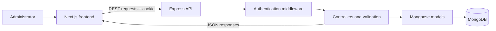

# 🩺 Doctor Tracker

<p align="center">
  <strong>A modern, full-stack healthcare administration dashboard.</strong><br />
  Manage doctors, organize patient records, track key metrics, and keep everyday clinic administration in one responsive workspace.
</p>

<p align="center">
  <a href="https://doctor-tracker-sage.vercel.app/"><strong>🚀 Open Live Demo</strong></a>
  &nbsp;·&nbsp;
  <a href="https://github.com/OrpanAp/doctor-tracker">Source Code</a>
  &nbsp;·&nbsp;
  <a href="https://doctor-tracker-2scb.onrender.com/api/health">API Health</a>
</p>

<p align="center">
  
  
  
  
  
  
</p>

---

## ✨ At a glance

Doctor Tracker is a responsive administrative application built to make everyday doctor and patient record management simpler. It combines searchable directories, doctor–patient assignments, secure administrator authentication, and an analytics dashboard in a single interface.

**Live application:** [doctor-tracker-sage.vercel.app](https://doctor-tracker-sage.vercel.app/)  
**Backend health endpoint:** [doctor-tracker-2scb.onrender.com/api/health](https://doctor-tracker-2scb.onrender.com/api/health)  
**Repository:** [github.com/OrpanAp/doctor-tracker](https://github.com/OrpanAp/doctor-tracker)

> **Demo safety:** Sign in using an administrator account configured for the environment. Never publish credentials or enter real patient information into a public demo.

## 🧭 Explore the application

- **Dashboard** — review doctor and patient totals, active/inactive doctors, recent patients, patient groupings, and six-month registration trends.
- **Doctors** — create and maintain doctor profiles, search and filter records, paginate results, and open a doctor's patient list.
- **Patients** — manage patient records, find entries quickly, filter by condition or assigned doctor, and maintain doctor assignments.
- **Authentication** — use an administrator sign-in flow with a server-managed HTTP-only session cookie.

## 🚀 Feature highlights

### Doctor directory
- Create, view, edit, and delete doctor records.
- Store name, specialty, hospital, department, email, phone, experience, and status.
- Search and filter by status, specialty, hospital, and registration-date range.
- Use paginated results and navigate to each doctor's patient list.

### Patient directory
- Create, view, edit, and delete patient records.
- Search and filter by condition, assigned doctor, and registration-date range.
- Assign patients to doctors and browse records with pagination.
- Prevent deleting a doctor while patient records still reference them.

### Dashboard and data insights
- View total doctors and patients, including active/inactive doctor counts.
- Explore patient counts by doctor and condition.
- Review recent patient records and six-month registration charts.

### Responsive, resilient interface
- Compact card-based layouts through **1170px** and desktop layouts from **1171px**.
- Server-side validation and consistent API error responses.
- Duplicate-email handling, escaped search input, bounded pagination, and MongoDB indexes for common queries.

## 🧰 Technology stack

| Layer | Technologies |
| --- | --- |
| Frontend | Next.js App Router, React, Tailwind CSS |
| Backend | Node.js, Express.js |
| Database | MongoDB Atlas or local MongoDB, with Mongoose |
| Authentication | bcryptjs password hashing, JWT, HTTP-only cookies |
| Communication | REST API over HTTP(S) |
| Deployment | Vercel frontend, Render backend |

## 🏗️ Architecture

The frontend and backend are separate applications with clearly defined responsibilities. The Next.js frontend sends REST requests to the Express API; Mongoose models and MongoDB persist application data.



### Request flow
1. An administrator signs in with configured credentials.
2. The backend verifies the password hash and issues a JWT in an HTTP-only cookie.
3. Protected doctor, patient, and dashboard endpoints validate the session.
4. Controllers validate input, query or aggregate MongoDB data, and return JSON.
5. The frontend renders results, filters, pagination controls, and dashboard visualizations.

In production, the Next.js rewrite forwards same-origin `/api/*` requests to the standalone backend. This helps keep browser requests aligned with the cookie-based authentication setup.

## ⚙️ Run locally

### Requirements
- Node.js and npm (a current supported LTS release is recommended)
- MongoDB Atlas or a local MongoDB instance
- Git

### 1. Clone the repository

```bash
git clone https://github.com/OrpanAp/doctor-tracker.git
cd doctor-tracker
```

### 2. Configure the backend

```bash
cd backend
npm install
```

Copy `backend/.env.example` to `backend/.env` and set your own values:

```env
MONGODB_URI=your_mongodb_connection_string
CLIENT_URL=http://localhost:3000
JWT_SECRET=replace_with_a_long_random_secret
ADMIN_NAME=Administrator
ADMIN_EMAIL=admin@example.com
ADMIN_PASSWORD=replace_with_a_strong_password
```

Use a unique JWT secret of at least 32 characters and an administrator password of at least 12 characters. These are illustrative values, not working credentials. Keep `backend/.env` private and out of version control.

Create the initial administrator account:

```bash
npm run create-admin
```

The script hashes the password and does not overwrite an existing administrator.

**Optional migration:** If your database has older doctor records without the hospital field, run this once:

```bash
npm run migrate:doctor-hospital
```

Records missing a hospital value are marked `Not specified`; update them with the correct information afterward.

Start the backend and leave this terminal running:

```bash
npm run dev
```

The API defaults to `http://localhost:5000/api`. Verify it at [http://localhost:5000/api/health](http://localhost:5000/api/health).

### 3. Configure the frontend

Open a second terminal from the repository root:

```bash
cd frontend
npm install
```

Copy `frontend/.env.example` to `frontend/.env.local`. For local development, set:

```env
NEXT_PUBLIC_API_URL=http://localhost:5000/api
```

Start the frontend:

```bash
npm run dev
```

Visit [http://localhost:3000](http://localhost:3000) and sign in using the administrator credentials you configured in the backend.

### 4. Run project checks

Run these commands from the relevant directory.

**Backend** (`backend/`):

```bash
npm test
```

**Frontend** (`frontend/`):

```bash
npm run build
npm run lint
```

Run checks after making changes. A successful local build does not, by itself, guarantee that the hosted deployment is healthy.

## 🔌 REST API reference

Unless stated otherwise, doctor, patient, and dashboard endpoints require authentication.

| Method | Endpoint | Purpose |
| --- | --- | --- |
| `GET` | `/api/health` | Check API health |
| `POST` | `/api/auth/login` | Authenticate and set the session cookie |
| `POST` | `/api/auth/logout` | Clear the session cookie |
| `GET` | `/api/auth/me` | Return the current administrator |
| `GET` | `/api/dashboard` | Return totals, groupings, and six-month trends |
| `GET` / `POST` | `/api/doctors` | List/filter doctors or create a doctor |
| `GET` / `PATCH` / `DELETE` | `/api/doctors/:id` | Read, update, or delete a doctor |
| `GET` / `POST` | `/api/patients` | List/filter patients or create a patient |
| `GET` / `PATCH` / `DELETE` | `/api/patients/:id` | Read, update, or delete a patient |

### Directory filters

| Directory | Supported query parameters |
| --- | --- |
| Doctors | `page`, `limit`, `search`, `status`, `specialty`, `hospital`, `dateFrom`, `dateTo` |
| Patients | `page`, `limit`, `search`, `condition`, `doctor`, `dateFrom`, `dateTo` |

Date filters use `YYYY-MM-DD`; start and end dates are inclusive. The API limits page size to keep queries bounded.

## 🖼️ Screenshots

The repository includes screenshot references for the dashboard and responsive directories. If an image does not render, check that the corresponding file exists in the `screenshots/` directory on the current branch.

### Dashboard


### Doctor and patient directories


### Responsive breakpoint

| Compact layout — 1170px | Desktop layout — 1171px |
| --- | --- |
|  |  |

## 🔐 Security and data integrity

- Never commit real `.env` files, passwords, JWT secrets, or session cookies.
- Use HTTPS and a long, unique JWT secret in production.
- Limit MongoDB Atlas network access to trusted deployment sources where practical.
- Use fictional records for screenshots and public demonstrations.
- Login attempts are rate-limited; passwords are stored as bcrypt hashes.
- Doctor deletion is blocked while patients remain assigned, avoiding orphaned references.

## 🧠 Engineering notes

- **Separate services:** independently deployable frontend and API boundaries keep responsibilities clear.
- **HTTP-only cookie authentication:** JavaScript cannot directly read the session cookie; production still requires correct HTTPS, cookie, CORS, and origin configuration.
- **Bounded pagination:** directory endpoints return manageable pages and pagination metadata.
- **Database aggregation:** dashboard groupings and monthly trends are computed by MongoDB aggregation pipelines rather than loading every record into application memory.
- **Search trade-off:** substring search suits smaller administrative datasets; larger deployments may benefit from normalized search fields or MongoDB Atlas Search.

## 🗺️ Roadmap ideas

Potential future improvements include role-based permissions, audit logs, appointment scheduling, exportable reports, automated end-to-end tests, and richer accessibility checks.

## 👤 Project

**Doctor Tracker** — a full-stack portfolio project demonstrating responsive UI development, REST API design, authentication, database-backed CRUD workflows, and dashboard analytics.

- **Live app:** https://doctor-tracker-sage.vercel.app/
- **Repository:** https://github.com/OrpanAp/doctor-tracker
- **API health:** https://doctor-tracker-2scb.onrender.com/api/health

---

<p align="center">
  Built with care to make healthcare administration feel more organized.
</p>
