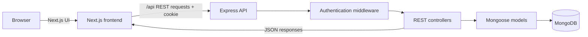
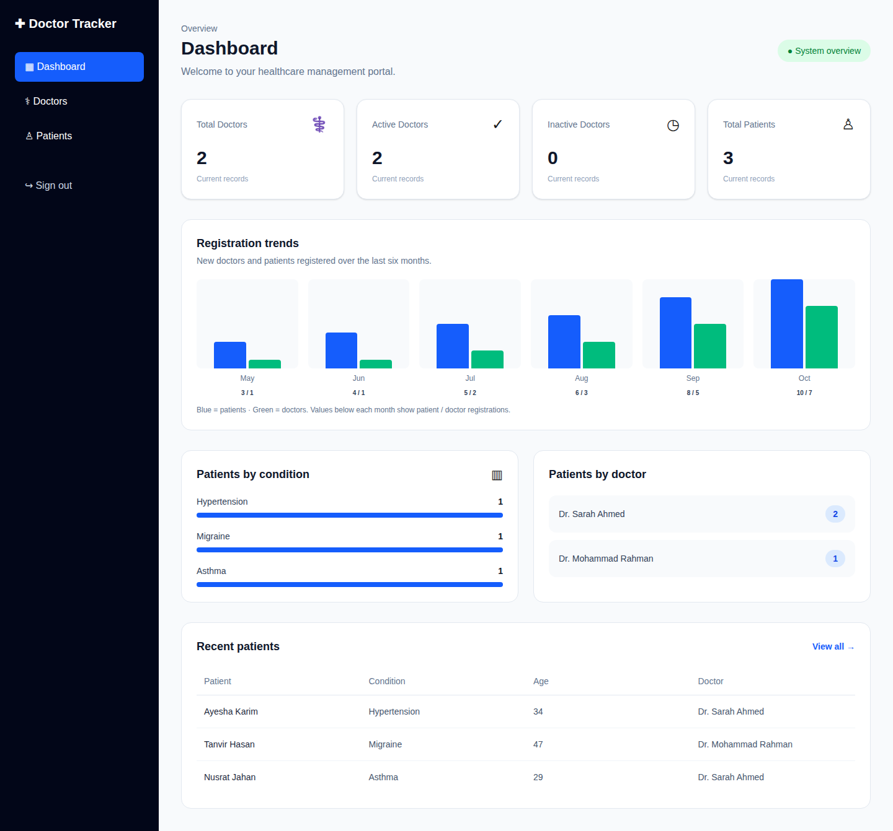
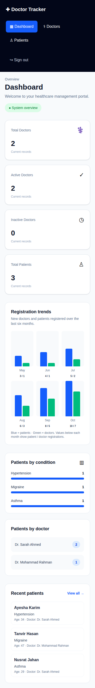
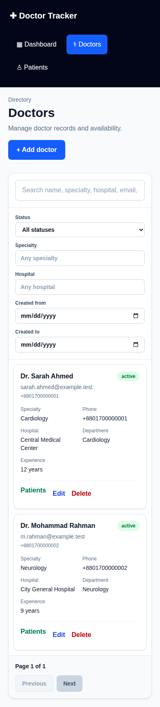
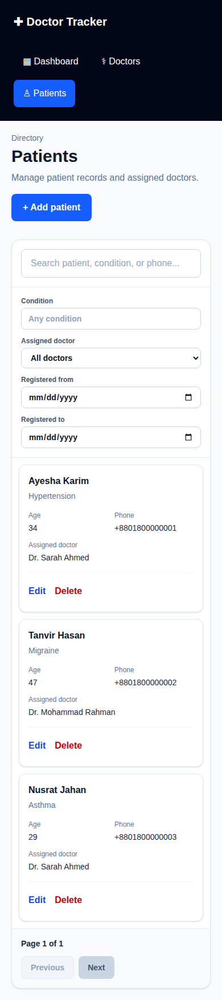
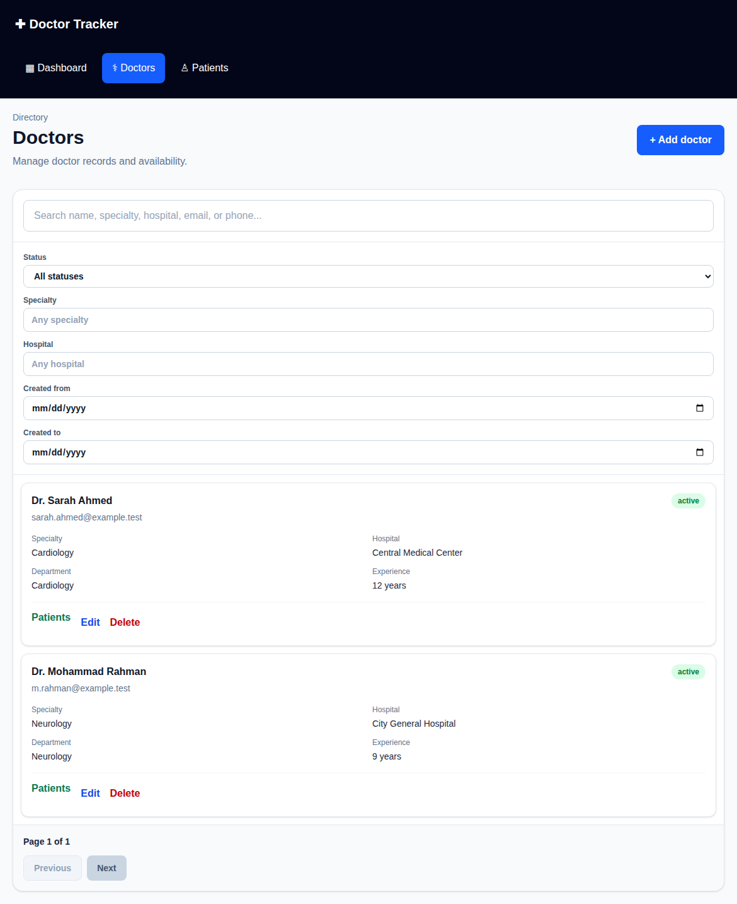
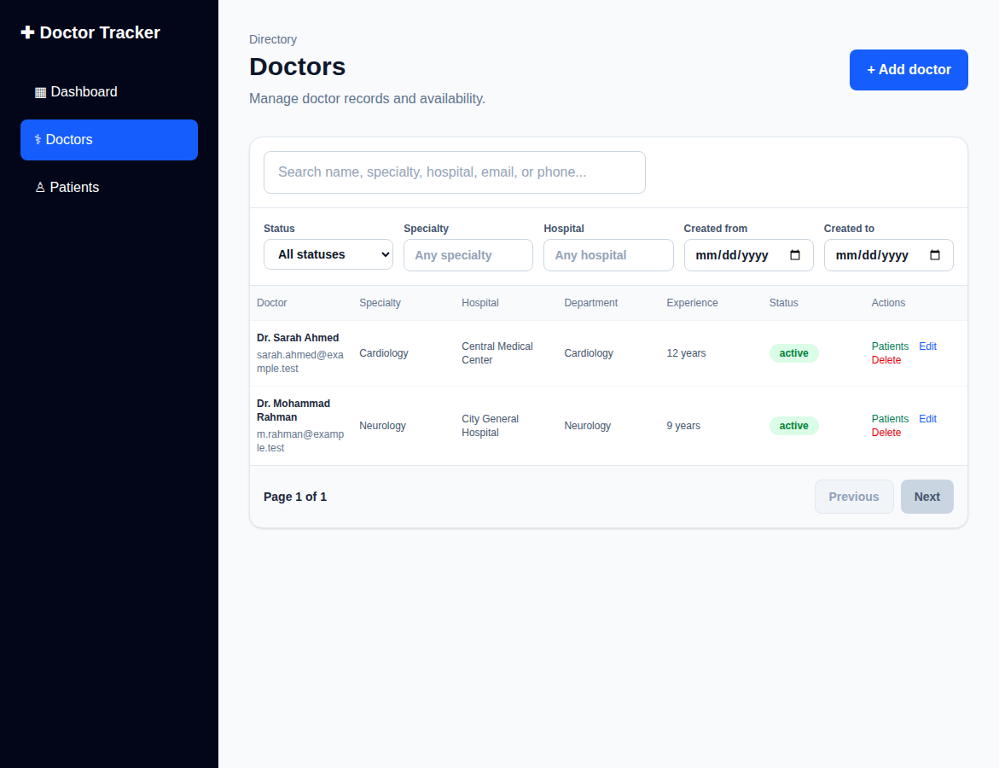

# Doctor Tracker

Doctor Tracker is a responsive administrative portal for securely managing doctors and their patients. Administrators can search, filter and paginate records, maintain doctor–patient assignments, and review current totals and six-month registration trends from a single dashboard.

## Live demo and source

- **Frontend:** https://doctor-tracker-sage.vercel.app/
- **Backend health check:** https://doctor-tracker-2scb.onrender.com/api/health
- **GitHub repository:** https://github.com/OrpanAp/doctor-tracker

Use your own administrator account for the demo. Do not publish or commit real passwords or patient data.

## Features

- JWT authentication in HTTP-only cookies, logout, protected REST endpoints, and rate-limited login attempts.
- Doctor management: create, list, edit, delete, search, status/specialty/hospital filters, registration-date range, pagination, and a shortcut to each doctor's patient list.
- Doctor records include name, specialty, hospital, phone, email, department, years of experience and status.
- Patient management: create, list, edit, delete, search, filter by condition, assigned doctor and registration-date range, and pagination.
- Dashboard: doctor and patient totals, active/inactive doctors, patient counts by doctor and condition, recent patients, and six-month doctor/patient registration charts.
- Server-side validation, consistent API errors, duplicate-email handling, safe search escaping, MongoDB indexes and bounded pagination.
- Compact card-based layouts through **1170px**; desktop tables/layout start at **1171px**.

## Technology stack

- Frontend: Next.js App Router, React, Tailwind CSS
- Backend: Node.js, Express.js
- Database: MongoDB Atlas or local MongoDB, accessed with Mongoose
- API: REST over HTTP(S)
- Authentication: bcryptjs password hashes, JWT and HTTP-only cookies

The frontend and API are separate applications. The frontend communicates with the standalone Express API through REST endpoints. In production, Next.js rewrites same-origin `/api/*` requests to the backend to avoid cross-origin cookie issues.

## Architecture and data flow



- The browser renders the dashboard and directory pages.
- Login validates credentials against a bcrypt password hash and sets an HTTP-only JWT cookie.
- Doctor, patient and dashboard endpoints require a valid session.
- Controllers validate inputs, build MongoDB filters, and return paginated JSON.
- The dashboard uses aggregation pipelines for patient groupings and monthly registration statistics.

## Technical decisions

### 1. Separate frontend and backend with a REST API

The specification explicitly requires a separate Next.js client and standalone Express server. Keeping the services separate gives the UI and API clear responsibilities, allows the API to be tested independently, and makes each service deployable on its own. The frontend's production rewrite sends `/api/*` calls to the Express service while keeping browser requests same-origin for cookie handling.

### 2. HTTP-only JWT cookies rather than browser-managed tokens

Passwords are stored as bcrypt hashes, and the server issues a short-lived JWT in an HTTP-only cookie after successful login. JavaScript cannot read the cookie directly, reducing exposure to token theft through client-side scripts. The trade-off is that cookie-based authentication requires careful HTTPS, CORS, SameSite and origin configuration; the deployment must keep the frontend origin and backend cookie settings aligned. Login attempts are rate-limited.

### 3. Bounded pagination and aggregation

Directory endpoints cap page size, run record queries and count queries concurrently, and return pagination metadata so the UI can render predictable controls. Dashboard groupings use MongoDB aggregation rather than loading all records into application memory. Indexes support common relationship, date, status and condition queries. Regex-based substring search is convenient for a small administrative dataset; for very large datasets, consider normalized search fields or MongoDB Atlas Search.

## Prerequisites

- Node.js (use a current supported LTS release) and npm
- A MongoDB database (local MongoDB or MongoDB Atlas)
- Git

## Local setup

### 1. Clone the repository

```bash
git clone https://github.com/OrpanAp/doctor-tracker.git
cd doctor-tracker
```

### 2. Configure and start the backend

```bash
cd backend
npm install
```

Copy `backend/.env.example` to `backend/.env` and fill in your own values:

- `MONGODB_URI`: your database connection string
- `CLIENT_URL=http://localhost:3000`
- `JWT_SECRET`: a random secret of at least 32 characters
- `ADMIN_NAME`, `ADMIN_EMAIL`, `ADMIN_PASSWORD`: initial administrator details; use a password of at least 12 characters

Generate a strong JWT secret instead of using the example value. Never commit `backend/.env`.

Create the initial admin account (the script hashes the password and will not overwrite an existing account):

```bash
npm run create-admin
```

If the database already contains doctor records without the new hospital field, run the one-time migration:

```bash
npm run migrate:doctor-hospital
```

It marks missing hospital values as `Not specified`; edit those records to enter the real hospital name.

Start the API in a terminal and keep it running:

```bash
npm run dev
```

The default API base is `http://localhost:5000/api`. Check `http://localhost:5000/api/health`.

### 3. Configure and start the frontend

Open a second terminal from the repository root:

```bash
cd frontend
npm install
```

Copy `frontend/.env.example` to `frontend/.env.local`. The default value is:

```env
NEXT_PUBLIC_API_URL=http://localhost:5000/api
```

Start the frontend:

```bash
npm run dev
```

Open http://localhost:3000 and sign in with the admin credentials you configured. Do not add real credentials to the repository.

### 4. Checks

From `backend/`:

```bash
npm test
```

From `frontend/`:

```bash
npm run build
npm run lint
```

These commands should be run after changes and before submission. A successful local run does not by itself prove the hosted deployment is healthy.

## REST API overview

All doctor, patient and dashboard endpoints require authentication.

| Method | Endpoint | Purpose |
|---|---|---|
| POST | `/api/auth/login` | Authenticate and set session cookie |
| POST | `/api/auth/logout` | Clear session cookie |
| GET | `/api/auth/me` | Return current administrator |
| GET | `/api/health` | API health check |
| GET | `/api/dashboard` | Totals, groupings and six-month trends |
| GET / POST | `/api/doctors` | List/filter or create doctors |
| GET / PATCH / DELETE | `/api/doctors/:id` | Read, update or delete a doctor |
| GET / POST | `/api/patients` | List/filter or create patients |
| GET / PATCH / DELETE | `/api/patients/:id` | Read, update or delete a patient |

### Directory query parameters

- Doctors: `page`, `limit`, `search`, `status`, `specialty`, `hospital`, `dateFrom`, `dateTo`.
- Patients: `page`, `limit`, `search`, `condition`, `doctor`, `dateFrom`, `dateTo`.

Dates use `YYYY-MM-DD`; the start and end dates are inclusive. Page size is bounded by the API.

## Visual evidence

The following screenshots are generated from the production-built Next.js UI by the CI workflow using fictional demo records (no real database or patient information). The capture job also checks the compact/desktop boundary at 1170px and 1171px.

### Dashboard





### Doctor and patient directories





### Required responsive breakpoint

| Compact layout — 1170px | Desktop layout — 1171px |
|---|---|
|  |  |

The screenshot job commits these files to the pull request branch after the backend tests, frontend production build, and lint checks pass.

## Security and data notes

- Keep all `.env` files out of version control; commit only example files without secrets.
- Use HTTPS in production and a long, unique JWT secret.
- Restrict MongoDB Atlas network access to the deployment environment where possible.
- Use fictional data for demonstrations.
- A doctor with assigned patients cannot be deleted until those patients are reassigned or deleted, preventing orphaned patient references.

## Current validation status

Automated tests cover shared search/date-filter utilities. Before claiming production readiness, run the backend test suite, frontend build/lint, and manual login/CRUD/filter/pagination checks against the deployed environment. Add the genuine screenshots listed above before submitting.
