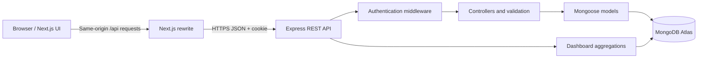

# Doctor Tracker

A full-stack healthcare administration application for managing doctors, patient records, doctor assignments, and registration analytics.

- **Live application:** https://doctor-tracker-sage.vercel.app/
- **Backend health check:** https://doctor-tracker-2scb.onrender.com/api/health
- **Source code:** https://github.com/OrpanAp/doctor-tracker

> Use fictional records for demonstrations. Do not enter real patient health information into a demo deployment.

## Features

### Authentication and security
- Administrator login using JWT stored in an HTTP-only cookie.
- Protected doctor, patient, and dashboard API routes.
- Password hashing, Helmet security headers, credentialed CORS, and centralized API error responses.
- Production frontend requests use the same-origin `/api` path, which is proxied to the backend to reduce cross-site cookie problems.

### Doctor directory
- Create, view, edit, and delete doctor records.
- Fields: name, specialty, email, phone, department, hospital/clinic, years of experience, and active/inactive status.
- Search by name, specialty, email, department, or hospital.
- Filter by status, specialty, and record creation date.
- Server-side pagination with configurable page size, total count, first/previous/next/last navigation.
- Shortcut to open the patient directory filtered to a selected doctor.

### Patient directory
- Create, view, edit, and delete patient records.
- Assign each patient to an existing doctor.
- Search by patient name, condition, or phone.
- Filter by condition, assigned doctor, and record creation date.
- Server-side pagination with total count and page-size controls.

### Dashboard
- Total doctors, active/inactive doctors, total patients, and patients registered in the last 30 days.
- Patients by condition and patients by doctor.
- Monthly patient registration trend for the last six months.
- Recent patient records.

## Architecture



The frontend and backend are separate applications. The frontend owns the UI and calls the backend through the `/api` path in production. Express handles authentication, request validation, CRUD operations, filtering, pagination, and dashboard aggregation. Mongoose models define persistence and indexes.

## Technology stack

- **Frontend:** Next.js, React, Tailwind CSS
- **Backend:** Node.js, Express
- **Database:** MongoDB / MongoDB Atlas with Mongoose
- **Authentication:** JSON Web Tokens in HTTP-only cookies
- **Deployment:** Vercel (frontend), Render (backend)

## Repository structure

```text
doctor-tracker/
├── backend/
│   ├── src/
│   │   ├── controllers/
│   │   ├── middleware/
│   │   ├── models/
│   │   ├── routes/
│   │   ├── app.js
│   │   └── server.js
│   └── .env.example
├── frontend/
│   ├── src/app/
│   │   ├── dashboard/
│   │   ├── doctors/
│   │   ├── login/
│   │   └── patients/
│   └── next.config.mjs
└── README.md
```

## Run locally

### Prerequisites
- Node.js and npm
- A local MongoDB instance or MongoDB Atlas database
- Git

### 1. Clone the repository

```bash
git clone https://github.com/OrpanAp/doctor-tracker.git
cd doctor-tracker
```

### 2. Configure the backend

```bash
cd backend
npm install
cp .env.example .env
```

On Windows Git Bash, the `cp` command above works. Open `backend/.env` and set your own values for `MONGODB_URI`, `JWT_SECRET`, and administrator credentials. Keep this file private and never commit it.

### 3. Start the backend

```bash
npm run dev
```

The API normally listens on `http://localhost:5000`. Confirm it is running by opening:

`http://localhost:5000/api/health`

### 4. Configure and start the frontend

Open a second terminal:

```bash
cd frontend
npm install
```

For local development, create `frontend/.env.local` with:

```dotenv
NEXT_PUBLIC_API_URL=http://localhost:5000/api
```

Then run:

```bash
npm run dev
```

Open http://localhost:3000. Configure the backend's `CLIENT_URL` to match the local frontend origin. The actual environment variable names are documented in `backend/.env.example`.

## API overview

All endpoints below use the `/api` prefix. Doctor, patient, and dashboard endpoints require an authenticated administrator session.

| Method | Endpoint | Purpose |
|---|---|---|
| POST | `/api/auth/login` | Sign in |
| GET | `/api/auth/me` | Get current session |
| POST | `/api/auth/logout` | Sign out |
| GET | `/api/health` | Health check |
| GET | `/api/dashboard` | Dashboard totals and analytics |
| GET | `/api/doctors?page=1&limit=10` | List doctors with pagination |
| POST | `/api/doctors` | Create doctor |
| GET | `/api/doctors/:id` | Get doctor |
| PATCH | `/api/doctors/:id` | Update doctor |
| DELETE | `/api/doctors/:id` | Delete doctor |
| GET | `/api/patients?page=1&limit=10` | List patients with pagination |
| POST | `/api/patients` | Create patient |
| GET | `/api/patients/:id` | Get patient |
| PATCH | `/api/patients/:id` | Update patient |
| DELETE | `/api/patients/:id` | Delete patient |

### List query parameters

- Doctors: `page`, `limit` (1–100), `search`, `status`, `specialty`, `dateFrom`, `dateTo`.
- Patients: `page`, `limit` (1–100), `search`, `condition`, `doctor` (doctor ID), `dateFrom`, `dateTo`.

List endpoints return the records in `data` and pagination metadata in `pagination`, including `total`, `page`, `limit`, and `totalPages`.

## Technical decisions

### 1. HTTP-only cookie authentication
The JWT is stored in an HTTP-only cookie rather than browser local storage. This prevents client-side JavaScript from reading the token directly. The frontend includes credentials in API requests, and the production Next.js rewrite proxies API traffic through the frontend origin to avoid common cross-site cookie restrictions. Cookie settings and allowed origins must still be configured correctly for each deployment environment.

### 2. Server-side pagination and filtering
Pagination and filters are applied in MongoDB before records are returned to the browser. The API runs a paginated query and a matching count query, then returns both records and pagination metadata. This avoids downloading the entire collection for each page. Page size is capped at 100 to prevent accidental oversized requests.

### 3. Aggregation for dashboard analytics
MongoDB aggregation pipelines group patient records by condition, assigned doctor, and registration month. This keeps summary calculations in the database rather than transferring all patient documents to the frontend.

## Screenshots

Screenshots should be captured from the running application and added here before the project is submitted. Recommended files:

- `screenshots/dashboard.png`
- `screenshots/doctors.png`
- `screenshots/patients.png`
- `screenshots/mobile.png`

Use fictional demo records only. Do not include credentials, cookies, environment files, or real patient data in screenshots.

## Build and verification

From the frontend directory:

```bash
npm run build
```

Before merging changes or submitting the project, verify:
- Login, logout, and expired-session redirect.
- Doctor and patient create/edit/delete workflows.
- Search and every filter, including date ranges.
- First/previous/next/last pagination and page-size changes.
- Viewing patients from a doctor row.
- Dashboard totals and monthly registration trend.
- Responsive layout on desktop and mobile.

## Deployment

- Frontend: https://doctor-tracker-sage.vercel.app/
- Backend health endpoint: https://doctor-tracker-2scb.onrender.com/api/health
- Repository: https://github.com/OrpanAp/doctor-tracker

Set production secrets in the hosting providers' environment-variable settings. Never commit `.env` files, JWT secrets, administrator passwords, cookies, or real patient data.
